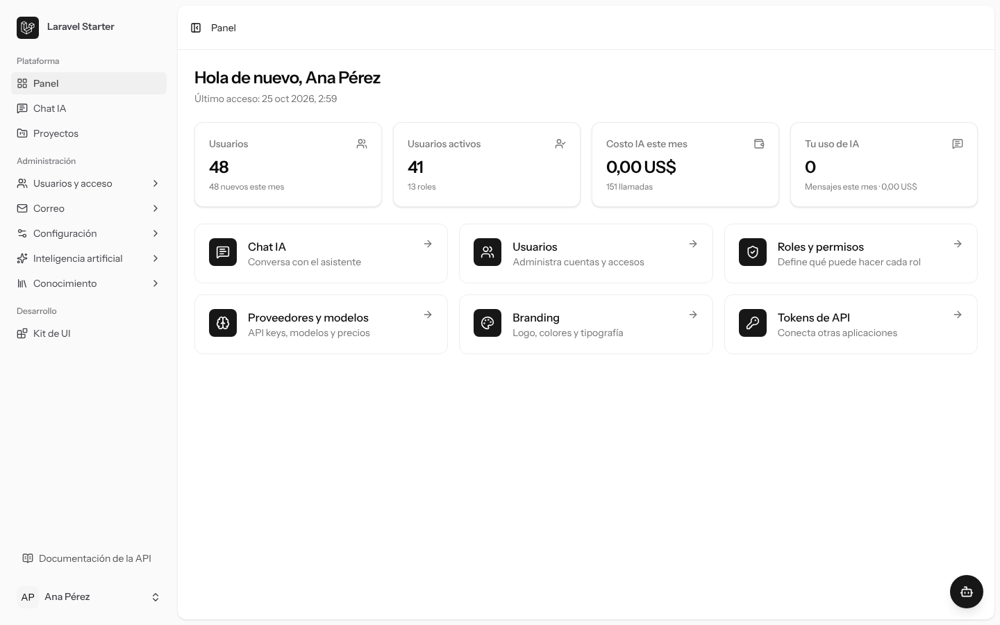
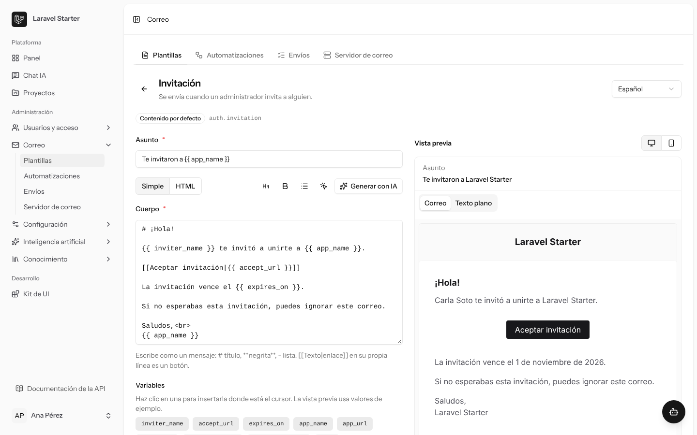
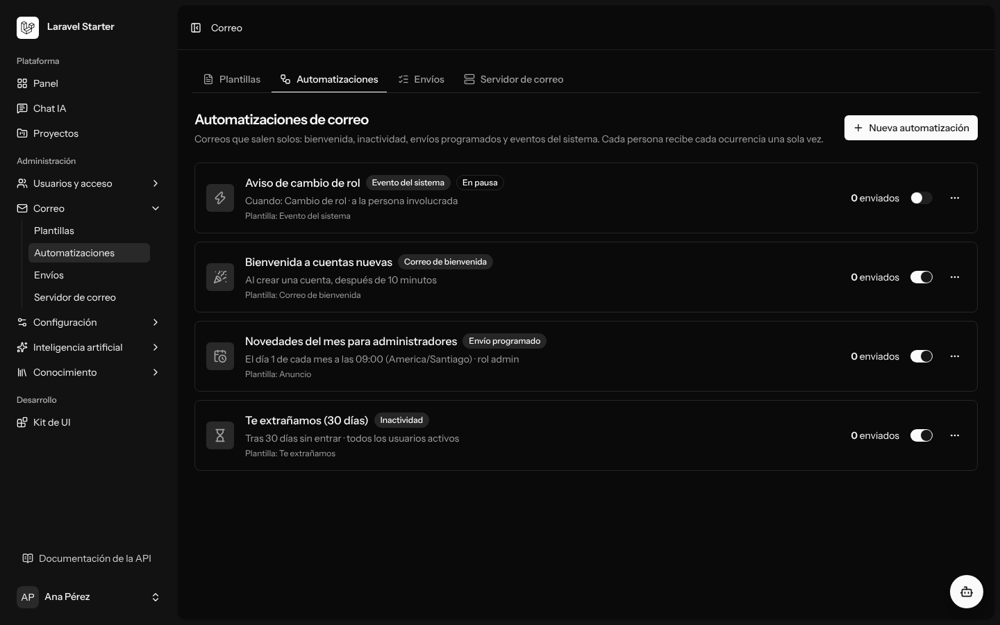
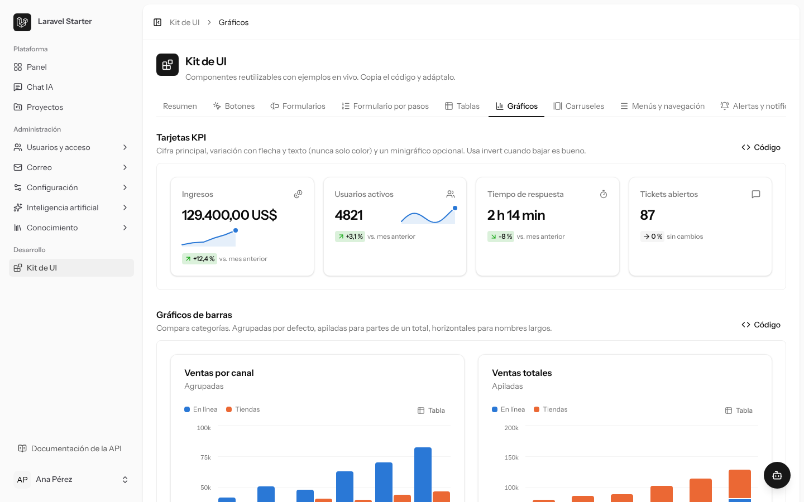
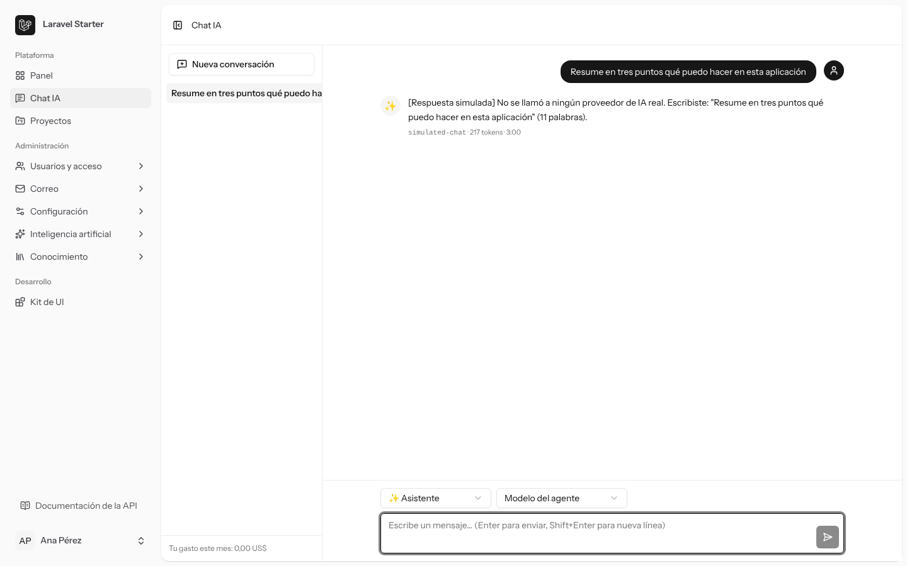
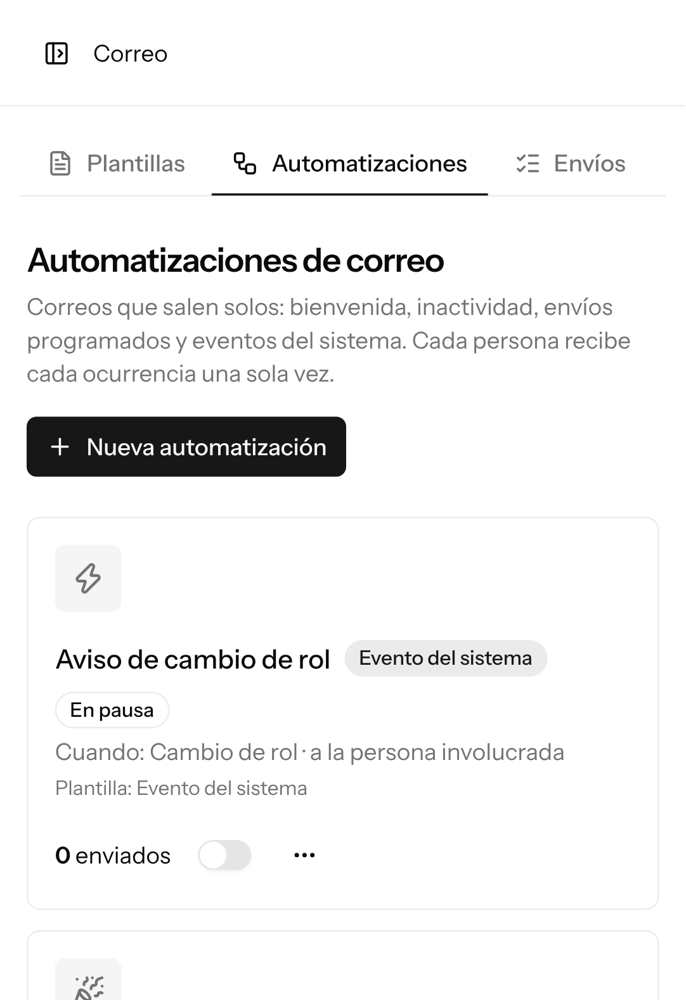

<p align="center">
  
</p>

<p align="center">
  <a href="https://github.com/bluesmilecl/startkit_laravel/actions/workflows/ci.yml"></a>
  <a href="https://github.com/bluesmilecl/startkit_laravel/actions/workflows/e2e.yml"></a>
  
  
  
  
  
</p>

<p align="center">
  <b>Un comando para instalar · funciona sin claves de IA · se despliega en Dokploy</b><br>
  <a href="#instalación">Instalar</a> ·
  <a href="#qué-incluye">Qué incluye</a> ·
  <a href="#capturas">Capturas</a> ·
  <a href="#arquitectura">Arquitectura</a> ·
  <a href="#inteligencia-artificial">IA</a> ·
  <a href="#conocimiento-rag">RAG</a> ·
  <a href="#correo">Correo</a> ·
  <a href="#despliegue-en-dokploy">Despliegue</a> ·
  <a href="#para-agentes-de-ia">Agentes de IA</a> ·
  <a href="#documentación">Docs</a>
</p>

> **TL;DR (English)**: a production-minded Laravel 13 starter kit with real AI built in:
> versioned agents with cost ledger and budgets, permission-aware RAG on PostgreSQL/pgvector,
> mail templates and automations, passwordless login, roles and audit trail, a REST API with
> a generated TypeScript client, a Vue 3 + shadcn-vue UI kit, Docker for local work and
> Dokploy for production. `./setup.sh --owner=you@example.com` installs everything; without
> API keys the AI answers through a simulated provider. Docs are in Spanish.

## ¿Qué es?

Una base para empezar proyectos reales con IA sin rehacer lo de siempre. Trae resuelto lo
que todo producto necesita y casi nunca está en un starter: acceso seguro, permisos,
auditoría, costos de IA bajo control, búsqueda con citas que respeta permisos, correo
configurable, API documentada, pantallas consistentes y un despliegue repetible.

| Principio | En la práctica |
| --- | --- |
| **Funciona desde el primer minuto** | Sin claves de IA responde el proveedor simulado y lo dice; el correo cae en Mailpit o en el log |
| **Una sola regla de negocio** | Panel, API y herramientas del chat llaman a las mismas *Actions*, que autorizan, validan y auditan |
| **Costos nunca inventados** | Toda llamada queda en el libro de consumo; una tarifa desconocida da costo `null`, nunca cero |
| **Seguro por defecto** | Permisos explícitos (sin `Gate::before`), secretos cifrados, listas de acceso dentro del SQL, lectura de URLs sin SSRF y plantillas que nunca se compilan como Blade |
| **Listo para agentes** | `AGENTS.md`, `CLAUDE.md` y skills para que una IA instale, extienda y despliegue el proyecto sin preguntar |

## Instalación

<p align="center">
  
</p>

```bash
git clone https://github.com/bluesmilecl/startkit_laravel.git
cd startkit_laravel
./setup.sh --owner=tu@correo.com
```

`setup.sh` usa **Docker** si está disponible (no necesitas PHP ni Node) o tus herramientas
locales. No hace preguntas, se puede repetir, devuelve códigos de salida documentados y con
`--json` deja un resumen para agentes. Detalle completo en **[INSTALL.md](INSTALL.md)**.

| Quiero… | Comando |
| --- | --- |
| Probarlo | `./setup.sh --owner=tu@correo.com` |
| **Mi propio proyecto** (historial nuevo, la plantilla queda como remoto `starter`) | `git clone --depth 1 https://github.com/bluesmilecl/startkit_laravel.git mi-app && cd mi-app && ./setup.sh --new-project="Mi App" --owner=tu@correo.com` |
| Correo real con Resend | `RESEND_API_KEY=re_… ./setup.sh --mail-from=hola@tudominio.com` |
| Forzar un modo | `./setup.sh --docker` o `./setup.sh --local` |
| Configurar todo desde un archivo | `./setup.sh --config=starter.config.json` |

| Modo | Necesitas | Queda en |
| --- | --- | --- |
| Docker | Docker con Compose v2 | App <http://localhost:8080> · códigos de acceso en Mailpit <http://localhost:8025> |
| Local | PHP 8.3+ (pdo_pgsql, intl, mbstring, zip), Composer 2, Node 22.12+, pnpm 10 y PostgreSQL 16+ | `cd apps/platform && composer dev` → <http://localhost:8000> · códigos en el log |

Entra con el correo del propietario: te llega un código de un solo uso. Revisa el estado
cuando quieras con `php apps/platform/artisan starter:verify`.

## Qué incluye

| Área | Lo que trae | Guía |
| --- | --- | --- |
| 🔐 **Acceso** | Login con código por correo, contraseña opcional, registro abierto, por invitación o cerrado, confirmación de acciones sensibles, sesiones y propietario con onboarding | [identity.md](docs/identity.md) |
| 🛡️ **Roles y auditoría** | `owner`, `admin`, `editor`, `reader` y roles propios, delegación (nadie otorga lo que no tiene) y auditoría de cada cambio por web, API, CLI o chat | [identity.md](docs/identity.md) |
| 🤖 **IA** | Conexiones a OpenAI, Anthropic, Gemini, DeepSeek, OpenRouter, Bedrock, Azure, Groq, Mistral, xAI, Ollama y APIs compatibles; catálogo, tarifas, libro de consumo, presupuestos, agentes versionados, chat flotante con adjuntos y micrófono, recomendador y laboratorio | [ai.md](docs/ai.md) |
| 📚 **Conocimiento (RAG)** | Colecciones, ingesta durable, búsqueda híbrida con listas de acceso, respuestas con citas validadas, laboratorio, evaluaciones y fuentes externas | [knowledge.md](docs/knowledge.md) |
| ✉️ **Correo** | Resend, SMTP (con ajustes para Gmail, SES, Brevo, SendGrid, Zoho), Postmark y Mailgun; prueba desde el panel; plantillas editables con IA y automatizaciones | [mail.md](docs/mail.md) |
| 🔌 **API** | REST `/api/v1` con Sanctum, OpenAPI generado, referencia en Markdown y cliente TypeScript; PostgREST opcional | [api-reference.md](docs/api-reference.md) |
| 🎨 **Kit de UI** | shadcn-vue + Tailwind 4: formularios, wizard, tablas con modo tarjetas, gráficos accesibles, modales, menús y toasts, con catálogo en vivo en `/ui-kit` | [ui-kit.md](docs/ui-kit.md) |
| 🧩 **Módulos** | `starter:make-module` genera migración, modelo, permisos, Actions, páginas, API, herramientas IA, docs y pruebas | [modules.md](docs/modules.md) |
| 🚀 **Operación** | Docker Compose con perfiles, cola y scheduler sobre PostgreSQL, `/health`, `starter:doctor` y despliegue en Dokploy | [docker.md](docs/docker.md) · [dokploy.md](docs/dokploy.md) |
| ✅ **Calidad** | PHPUnit sobre PostgreSQL real, PHPStan, Pint, vue-tsc, Playwright E2E y CI en cada pull request | [e2e.md](docs/e2e.md) |

## Capturas

<table>
  <tr>
    <td width="50%"><br><sub><b>Panel</b> · indicadores y accesos según tus permisos</sub></td>
    <td width="50%"><br><sub><b>Editor de plantillas</b> · variables con un clic, vista previa en vivo y borrador con IA</sub></td>
  </tr>
  <tr>
    <td><br><sub><b>Automatizaciones</b> · bienvenida, inactividad, envíos programados y eventos (modo oscuro)</sub></td>
    <td><br><sub><b>Kit de UI</b> · catálogo en vivo con el código de cada pieza</sub></td>
  </tr>
  <tr>
    <td><br><sub><b>Chat de IA</b> · sin claves responde el proveedor simulado y lo indica</sub></td>
    <td align="center"><br><sub><b>En el teléfono</b> · barra lateral como panel y tarjetas responsivas</sub></td>
  </tr>
</table>

## Arquitectura

<p align="center">
  
</p>

Monolito modular en un monorepo Composer + pnpm. Inertia sirve las páginas Vue y la API
`/api/v1` cubre las integraciones; ambas usan las mismas *Actions* y *Policies*. La misma
imagen corre la web, la cola y el scheduler, todo sobre PostgreSQL (datos, sesiones, caché
y cola). Más en [architecture.md](docs/architecture.md).

```text
apps/platform/            Laravel 13 + Inertia + Vue (controladores, Actions, páginas)
packages/php/             administration · identity · ai · knowledge · starter-console
packages/js/              @starter/ui (shadcn-vue) · @starter/chat · @starter/api-client
tooling/create-starter/   Instalador laravel-starter y validador de starter.config.json
tooling/contracts/        OpenAPI y esquemas JSON
skills/                   Skills para agentes de desarrollo (enlazadas en .claude/skills/)
docker/                   Imagen, Nginx y Compose (local y Dokploy)
tests/e2e/                Pruebas Playwright
docs/                     Documentación
```

## Inteligencia artificial

<p align="center">
  
</p>

- **Toda llamada pasa por `laravel/ai`** y queda en el libro de consumo con tokens, latencia
  y costo calculado con decimales exactos. Si no se conoce la tarifa, el costo es `null`.
- **Presupuestos** por usuario, rol, función, conexión, agente o global, con reserva atómica
  antes de llamar: si no alcanza, la llamada se bloquea. Avisos por correo al 80 % y 100 %.
- **Agentes versionados**: el chat usa siempre la versión publicada y autorizada; nunca acepta
  instrucciones, herramientas ni colecciones enviadas por el cliente.
- **Herramientas con confirmación**: cuando el modelo quiere cambiar algo, el chat muestra una
  propuesta y no se ejecuta nada hasta que confirmas.
- **Sin claves** responde el proveedor simulado (`STARTER_AI_SIMULATED=true`). Las claves
  reales se agregan en el panel (cifradas) o como referencias `env:NOMBRE`.

## Conocimiento (RAG)

<p align="center">
  
</p>

Opcional con `STARTER_FEATURE_RAG=true`. La ingesta va por la cola y es idempotente; las URLs
se leen con protección anti-SSRF; la búsqueda combina pgvector y texto completo con
Reciprocal Rank Fusion, y **los permisos se aplican dentro de la consulta**, nunca en la
interfaz. Incluye laboratorio, conjuntos de evaluación (recall@k, MRR), reindexación
versionada y conexión a PostgreSQL externo o a una API de recuperación
([knowledge.md](docs/knowledge.md), [rag-external.md](docs/rag-external.md)).

## Correo

<p align="center">
  
</p>

- **Proveedores**: Resend por defecto, SMTP propio (con ajustes listos), Postmark y Mailgun.
  Se configuran y prueban desde **Administración → Correo**, incluso antes de guardar; las claves
  quedan cifradas. Nunca se activa un proveedor sin clave.
- **Plantillas** para códigos de acceso, invitaciones, recuperación de contraseña y avisos,
  editables por idioma con variables, formato simple o HTML, vista previa y borrador con IA.
- **Automatizaciones**: bienvenida, inactividad, envíos programados a un rol y eventos del
  sistema. Cada envío queda en **Envíos** con su estado y se puede reintentar.

## Despliegue en Dokploy

<p align="center">
  
</p>

Un servicio Compose por proyecto y entorno, construido desde GitHub con
`docker/compose.dokploy.yaml`, aislado, con Auto Deploy y dominio HTTPS. Las migraciones,
permisos y datos base corren antes de levantar la app; los secretos viven solo en el entorno
de Dokploy. Paso a paso, con el panel o con el MCP de Dokploy: [dokploy.md](docs/dokploy.md)
y la skill [deploy-dokploy](skills/deploy-dokploy/SKILL.md).

## Para agentes de IA

Copia esto en Claude Code, Codex, Cursor u otro agente con terminal:

```text
Crea mi proyecto "Mi App" a partir de https://github.com/bluesmilecl/startkit_laravel
siguiendo su INSTALL.md (sección "Tu proyecto desde la plantilla"). Propietario: tu@correo.com.
Usa Docker si está disponible. Si te doy RESEND_API_KEY, deja el correo con Resend.
Al terminar dime la URL, dónde llegan los códigos de acceso y qué quedó pendiente.
```

Al abrir el repositorio, cada agente recibe el contexto solo:

| Archivo | Para |
| --- | --- |
| [AGENTS.md](AGENTS.md) | Reglas, mapa del código, comandos y verificación (Codex, Cursor, Copilot y otros) |
| [CLAUDE.md](CLAUDE.md) | Claude Code: importa `AGENTS.md` y carga las skills de `.claude/skills/` |
| [GEMINI.md](GEMINI.md) · [copilot-instructions.md](.github/copilot-instructions.md) | Gemini CLI y GitHub Copilot |
| [llms.txt](llms.txt) | Índice corto para modelos |

| Skill | Cuándo |
| --- | --- |
| [install-starter](skills/install-starter/SKILL.md) | Instalar, configurar o diagnosticar |
| [extend-starter](skills/extend-starter/SKILL.md) | Agregar un módulo de negocio completo |
| [build-ui](skills/build-ui/SKILL.md) | Construir pantallas con el kit de UI |
| [configure-ai](skills/configure-ai/SKILL.md) | Conectar proveedores, modelos, tarifas y agentes |
| [manage-rag](skills/manage-rag/SKILL.md) | Activar y operar el conocimiento |
| [deploy-dokploy](skills/deploy-dokploy/SKILL.md) | Publicar un piloto o producción |

## Tu primer módulo

```bash
cd apps/platform
php artisan starter:make-module Task --field="title:string" --field="due_on:date:nullable" --ai
```

Genera la migración, el modelo, la Policy y los permisos, las Actions, el Form Request, las
páginas Vue con la tabla del kit, la API, herramientas para el chat, la documentación y las
pruebas. El módulo **Proyectos** está generado así y sirve de referencia
([modules.md](docs/modules.md)).

## Comandos

```bash
php artisan starter:doctor               # diagnóstico del entorno y los servicios
php artisan starter:verify               # doctor + configuración + contratos + migraciones + permisos
php artisan starter:owner tu@correo.com  # crea o promueve al propietario (--name="Tu Nombre")
php artisan starter:permissions          # catálogo de permisos y roles de sistema
php artisan starter:make-module Task     # módulo completo (--field="title:string" --ai)
php artisan starter:config-validate      # valida starter.config.json (esquema, secretos, reglas)
php artisan starter:config-apply         # aplica la configuración
php artisan starter:api-docs             # OpenAPI + docs/api-reference.md (luego pnpm api:client:generate)
php artisan starter:contracts-check      # contratos al día con el código
php artisan starter:ai-models-sync       # modelos de las conexiones de IA
php artisan starter:ai-prices-sync       # tarifas desde catálogos estructurados
php artisan starter:rag-doctor           # diagnóstico del conocimiento
php artisan starter:mail-automations     # envíos de inactividad y programados (el scheduler lo corre cada 5 min)
```

## Configuración

Lo principal está en `apps/platform/.env` (generado por `setup.sh`) y casi todo se ajusta
después desde el panel. Variables más usadas:

| Variable | Por defecto | Para |
| --- | --- | --- |
| `APP_URL` | `http://localhost:8000` | URL pública (enlaces de correo, cookies) |
| `MAIL_MAILER` · `RESEND_API_KEY` | `smtp` | Correo; con la clave de Resend, `setup.sh` deja Resend |
| `STARTER_AI_SIMULATED` | `true` | Proveedor simulado mientras no hay claves |
| `STARTER_FEATURE_RAG` | `false` | Activa el conocimiento (requiere pgvector) |
| `STARTER_FEATURE_POSTGREST` | `false` | PostgREST opcional con esquema `api` |
| `STARTER_AUTH_METHOD` | `email-otp` | `email-otp+password` habilita contraseñas |
| `STARTER_REGISTRATION` | `invite-only` | `open`, `invite-only` o `closed` |
| `TRUSTED_PROXIES` | vacío | `*` detrás de un proxy (Dokploy/Traefik) |
| `STARTER_OTP_FIXED_CODE` · `STARTER_OTP_FIXED_EMAILS` | vacío | Código fijo para pilotos; se ignora en producción |

`starter.config.json` permite dejar ajustes, conexiones de IA, agente, conocimiento y
propietario en un archivo versionable, sin secretos ([installer.md](docs/installer.md)).

## Calidad y pruebas

```bash
cd apps/platform
php artisan test                               # PHPUnit sobre PostgreSQL real (no SQLite)
composer lint:check && composer types:check    # Pint + PHPStan
cd ../.. && pnpm check && pnpm types:check     # lint, formato y vue-tsc
pnpm test:e2e                                  # Playwright (escritorio y móvil)
```

La CI corre todo esto en cada pull request y en cada push a `main`, incluidas las pruebas
E2E con PostgreSQL y un worker de cola en Chromium; Firefox y WebKit corren cada semana y en
cada versión ([e2e.md](docs/e2e.md)).

## Documentación

| Tema | Guía |
| --- | --- |
| Instalación rápida (personas y agentes) | [INSTALL.md](INSTALL.md) · [por modo](docs/installation.md) |
| Arquitectura | [architecture.md](docs/architecture.md) |
| Acceso, roles y auditoría | [identity.md](docs/identity.md) |
| IA: conexiones, costos, presupuestos y agentes | [ai.md](docs/ai.md) |
| Conocimiento (RAG), fuentes externas y PostgREST | [knowledge.md](docs/knowledge.md) · [rag-external.md](docs/rag-external.md) · [postgrest.md](docs/postgrest.md) |
| Correo, plantillas y automatizaciones | [mail.md](docs/mail.md) |
| Kit de UI | [ui-kit.md](docs/ui-kit.md) |
| Módulos, instalador y API | [modules.md](docs/modules.md) · [installer.md](docs/installer.md) · [api-reference.md](docs/api-reference.md) |
| Docker y Dokploy | [docker.md](docs/docker.md) · [dokploy.md](docs/dokploy.md) |
| Pruebas E2E, skills y actualizaciones | [e2e.md](docs/e2e.md) · [skills.md](docs/skills.md) · [upgrades.md](docs/upgrades.md) |
| Especificación completa | [especificacion.md](docs/especificacion.md) |

## Estado

Las ocho etapas de la [especificación](docs/especificacion.md) están implementadas y
cubiertas por pruebas. Lo que solo se verifica fuera del entorno de desarrollo: el proceso
PostgREST real ([postgrest.md](docs/postgrest.md)), `composer install` del instalador
publicado y las pruebas E2E en Firefox y WebKit (en CI). Fuera de alcance por ahora: búsqueda
web del catálogo de modelos y voz de salida.

## Licencia

[MIT](LICENSE).
